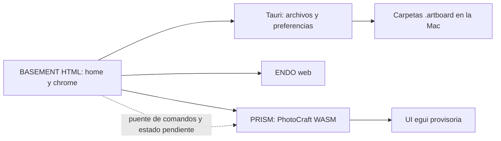

# 0001 — Arquitectura de BASEMENT

Fecha: 12 Oct. 2026. Estado: **propuesta; pendiente de aprobación de Santi**.
Checkpoint 2 aprobado. Esta prueba no comienza la Fase 4 ni cambia los motores.

## Recomendación

Usar **Tauri para BASEMENT, ENDO web y PRISM con PhotoCraft compilado a WASM**.
En esta Mac el motor abrió dentro de la app con WebGPU. Empezar PRISM con su UI
egui provisoria y reemplazar paneles gradualmente por el diseño de Santi, primero
Layers. El diseño final sigue siendo el de las referencias compartidas.

Antes de convertir la prueba en integración definitiva, construir una interfaz
explícita entre el shell y el motor para comandos, estado y archivos. La prueba
actual usa interceptación de teclado, selector web y descargas: sirve para medir
viabilidad, pero no es una interfaz estable para producción.

## Contexto

Queremos una app personal de Mac con Studios separados, home común y artboards
reales en disco. ENDO ya es web; PhotoCraft es Rust con UI egui y motor separado.
La pregunta era si su build web podía funcionar dentro del WebView de Tauri,
con acceso real a archivos, sin convertir BASEMENT en un launcher de apps separadas.

## Qué probamos y qué salió

Mac de Santi: macOS 26.6.2, Apple M2 Pro. PhotoCraft fijado en
`20cb95bc272feb9691537bccb46e84e583f5a04a`; Tauri 2.12.3; Trunk 0.21.14.

| Prueba | Resultado medido |
| --- | --- |
| Build web original, con HEIF | Pasó; 253,69 s incluyendo pasos de Trunk. |
| WASM generado, sin compresión de transporte | 25.063.798 bytes = 23,90 MiB. |
| App Tauri empaquetada, build debug | Aproximadamente 37,70 MiB. No es una medición de release ni memoria RAM. |
| Contexto local `tauri://localhost` | Seguro; `navigator.gpu` y `requestAdapter()` disponibles. |
| Inicio del motor con WebGPU | 1.134 ms en la primera prueba; log confirma `BrowserWebGpu`. |
| Cadencia breve de ventana, 180 callbacks rAF | Media 16,67 ms, p95 18 ms; aproximadamente 60 Hz. No mide FPS internos ni pincel en documentos grandes. |
| PSD leído desde el disco por Rust y pasado al editor | Pasó; el selector web recibió bytes de una copia del archivo de prueba. |
| Exportación del editor guardada en disco por Rust | Pasó con WebGPU; 92.971 bytes, 116 ms desde la petición de guardar hasta el archivo. |
| PSD exportado y reabierto con el motor nativo | Conservó las capas y produjo el mismo PNG que el render nativo de esa misma entrada. |
| WebGL2 forzado | Inicializó backend `Gl`, quitó el indicador de carga e importó el PSD. La repetición automática de guardado no confirmó una nueva exportación; no lo declaramos validado de punta a punta. |
| Comparación nativa pequeña | CLI: reabrir/reexportar PSD, 64–107 ms en tres ejecuciones. Incluye proceso e importación; no es directamente comparable con los 116 ms del guardado WASM. |
| Registro de comandos desde una sesión independiente | La CLI creó una capa y devolvió su árbol en unos 125 ms. Prueba que el motor se puede conducir; no sincroniza esa sesión con el editor WASM. |

La entrada utilizada incluye las ediciones de Santi sobre el PSD de prueba de la
Fase 2. Se congeló una copia para comparar ambas rutas contra **la misma revisión**.
No se sobreescribió su archivo. El PNG nativo de entrada y el PNG del PSD que volvió
de WASM comparten SHA-256 `867e5799e35d13ccde593b81a92ef708474c8bb40510ca8c58b7ea0b2501ecb6`.

El primer guardado produjo un archivo comprobable. Las repeticiones con atajos
simulados no solicitaron siempre una nueva exportación, incluso con WebGPU: un
documento limpio puede tener Guardar deshabilitado y el foco/diálogo egui importa.
La lectura y escritura nativa son viables, pero el adaptador de eventos todavía
no es una integración fiable. La demo registra `exportConfirmed` por separado
del estado de carga y necesita prueba manual; ésta es una razón concreta para
construir el puente tipado antes de prometer el ciclo `.artboard`.

La captura [del editor dentro de Tauri](evidence/prism-in-tauri.png) proviene de su
propio canvas WebGPU. La captura de ventana por macOS fue denegada. La lectura del
canvas GL devolvió negro, que puede deberse al buffer de dibujo; no alcanza para
afirmar ni descartar un problema visual de WebGL. El fallback necesita prueba visual
y guardado manual antes de considerarlo soportado.

## Dos caminos para la interfaz

| | UI PhotoCraft dentro del shell | Paneles HTML de BASEMENT |
| --- | --- | --- |
| Qué conserva | Canvas, herramientas, paneles y comportamiento egui existentes. | Motor, documentos, formatos y comandos; controles y sincronización propios. |
| Evidencia | Corre en Tauri con WebGPU y completó un guardado real. | Motor nativo y registry probados; todavía no existe un puente JS a la sesión WASM actual. |
| Fidelidad al diseño | Provisoria: necesita reemplazo gradual de paneles. | Permite seguir la referencia ENDO y la home de Santi. |
| Trabajo adicional estimado | 12–24 h para estabilizar puente de archivos y contratos, excluyendo home/artboards. | 20–40 h para puente y primer Layers; 120–240 h para sustituir ampliamente paneles y comportamiento de herramientas. |
| Riesgo principal | Acoplarse a detalles del frontend egui si usamos eventos DOM. | Duplicar estado, historial, selecciones y herramientas si la UI no consulta al motor. |

Las horas son rangos preliminares de trabajo técnico, no compromisos de entrega.
No incluyen corregir los problemas de PhotoCraft, fidelidad PSD compleja ni nuevos
Studios. El primer panel dará una estimación más precisa.

**Corrección importante a la hipótesis inicial:** el canal TCP/JSON y MCP de
PhotoCraft pertenecen al proceso nativo. El browser no escucha TCP y el loader
WASM generado sólo exporta inicialización, no `executeCommand` para el shell.
Para reemplazar Layers necesitamos exponer una cola de comandos y consultas de
estado en la sesión que ya dibuja el canvas, con callbacks de resultados/cambios.
Proponer ese pequeño adaptador en `endo-integration`, o un wrapper equivalente
fuera de vendor si sus APIs lo permiten, antes de editar el motor. Una CLI separada
sin sincronización no reemplaza esta conexión.

## Cómo quedaría

El guardado de la demo va a `.audit-runtime/spike/exports`; todavía no implementa
`~/Basement/`, guardado atómico de artboards, miniaturas ni registro de extensión.
Esos puntos corresponden a la Fase 4 y a las integraciones posteriores.
Tauri permite conectar el frontend con funciones Rust mediante commands;
esa API se usó para leer y guardar los bytes de la prueba.
[Documentación oficial](https://v2.tauri.app/develop/calling-rust/).

## Límites que quedan abiertos

- La ruta WebGPU está validada en **esta Mac**, no en otras versiones de macOS.
- Faltan documentos grandes, memoria, pincel sostenido, tablet y pérdida de GPU.
- No se hizo una comparación de rendimiento completa WASM/nativo; las muestras
  pequeñas y la cadencia de ventana no sirven para extrapolar rendimiento profesional.
- El selector nativo está conectado, pero su uso manual debe probarlo Santi.
- El prototipo limita archivos a 32 MiB y usa CSP deshabilitada. Para la app final
  hay que configurar permisos/CSP, rutas por artboard y guardado seguro.
- La `.app` debe permanecer en este checkout para encontrar sus archivos de prueba.
- Se conservaron LICENSE, NOTICE y atribuciones. La interfaz original es evidencia
  local del spike; el producto modificado debe retirar la marca/logos ArtCraft y
  aplicar BASEMENT conforme a las condiciones de licencia.
- No se implementó un panel HTML definitivo ni se modificó el código de vendor.

## Demo y checkpoint 3

Abrir `scripts/run-spike.command` o la app generada en
`shell/spike/src-tauri/target/debug/bundle/macos/BASEMENT Architecture Preview.app`.
Elegir **Abrir ejemplo PSD**, revisar capas y probar editar/guardar. El script
`scripts/build-spike.command` reconstruye WASM y la app; los outputs no van a Git.

**Decisión solicitada:** aprobar Tauri + WASM, con la UI egui provisoria y reemplazo
gradual hacia el diseño de Santi, condicionado a construir el puente explícito.
Con ese OK seguimos a Fase 4 (home, chrome y artboards). La arquitectura todavía
no está aprobada y no se comenzó esa implementación.

Evidencia: [WebGPU](evidence/webgpu-runtime.json), [cadencia](evidence/webgpu-cadence.json),
[guardado](evidence/webgpu-file-export.json), [comparación de píxeles](evidence/file-roundtrip.json),
[WebGL](evidence/webgl-runtime.json), [nativo](evidence/native-comparison.json),
[tamaños](evidence/sizes.json).
